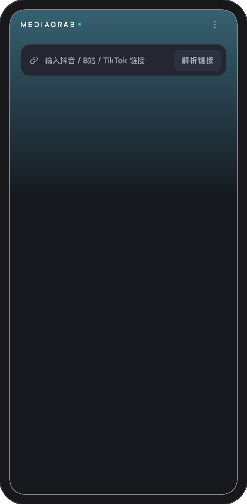
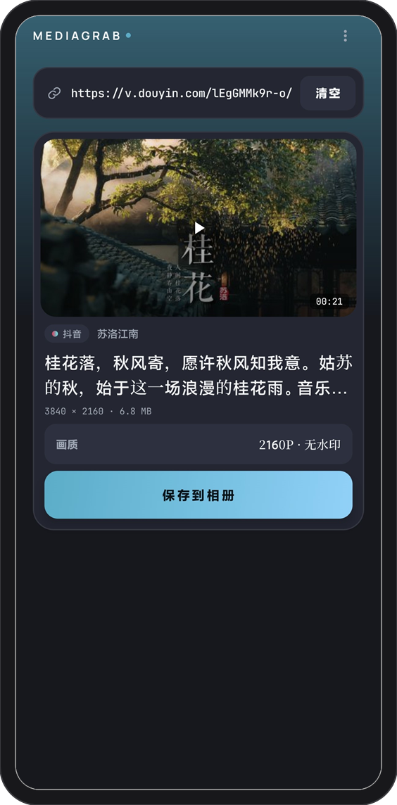
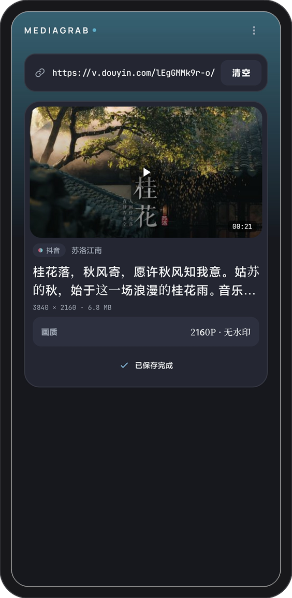

<p align="center">
  
</p>

<h1 align="center">MediaGrab</h1>

<p align="center">
  <a href="https://github.com/Alistairccc/media-grab-android/actions/workflows/android.yml"></a>
  <a href="https://github.com/Alistairccc/media-grab-android/releases/latest"></a>
  <a href="LICENSE"></a>
  
</p>

<p align="center"><strong>复制分享链接 → 输入 → 解析 → 保存到相册。</strong></p>

<p align="center"><a href="README.md">English</a> | 简体中文</p>

MediaGrab 是一个专注、轻量的 Android 视频保存工具，支持抖音、哔哩哔哩和 TikTok 的**单条视频**。不登录、不读取账号数据、不接管账号，只做一件事：把你有权保存的视频放进系统相册。

## 预览

<p align="center">
  
  
  
</p>

<p align="center"><em>输入 → 解析 → 保存。演示内容：抖音 @苏洛江南</em></p>

## 三步完成

1. **复制**：在抖音、B 站或 TikTok 复制视频分享链接
2. **输入**：打开 MediaGrab，在输入框中长按粘贴，或直接输入链接，然后点「解析链接」
3. **保存**：确认视频信息后点「保存到相册」

下载在后台进行，切到其他 App 也不会中断；完成后可以在系统相册的 `Movies/MediaGrab` 中找到文件。

## 功能

- **抖音**：解析无水印单文件视频，清晰度以接口返回为准（实测 1080P）
- **哔哩哔哩**：单条视频，带音轨 MP4；未登录画质以平台实际提供为准（实测单条 720P）
- **TikTok**：解析无水印单文件视频；解析时建立游客会话 Cookie 用于下载，不登录账号
- **直接输入**：在输入框中输入或长按粘贴分享链接，点右侧「解析链接」或键盘 Go
- **保存到相册**：直接写入 `Movies/MediaGrab`，不需要存储权限
- **后台下载**：前台服务 + 通知进度，支持取消
- **真实封面**：解析后显示视频封面，加载失败时回退当前主题的渐变占位
- **主题切换**：右上角菜单提供 Aloha 青、午夜蓝、紫罗兰、暖橙四套配色，选择后本地保存
- **语言切换**：右上角菜单提供 English 与简体中文；默认跟随系统语言，非中文系统回退英文，选择后本地保存
- **关于页**：版本、开源许可与 GitHub 仓库入口
- **干净**：无广告、无登录、无账号体系、无数据上传

## 支持范围

| 支持 | 暂不支持 |
|---|---|
| 抖音单条视频（分享短链 / 视频页链接） | 抖音图集、合集、直播 |
| B 站单条视频（`BV` 链接 / `b23.tv` 短链） | B 站番剧、直播、批量队列 |
| TikTok 单条视频（`/video/` 链接 / `vm.tiktok.com` 短链） | TikTok 图集、直播 |
| Android 10（API 29）及以上 | 1080P DASH 音视频合并 |
| 后台下载、通知取消 | 登录、账号同步、云端记录 |

## 常见问题

**需要登录吗？**
不需要。抖音解析所需的游客 Cookie 由 App 内隐藏 WebView 获取，只用于签名请求，不读取账号信息。

**视频保存在哪里？**
系统相册的 `Movies/MediaGrab`，也可以在文件管理器的同一路径下找到。

**为什么抖音第一次解析要等几秒？**
首次需要启动隐藏 WebView 获取游客 Cookie，之后会复用。网络较慢时等待时间会变长。

**TikTok 需要登录吗？**
不需要。解析时 App 会向 TikTok 建立游客会话 Cookie，仅用于读取公开视频和通过 CDN 校验，不涉及账号登录或账号数据。

**TikTok 为什么解析失败？**
TikTok 不向所有地区提供公开数据，部分地区或网络会返回限流或空响应。请先确认设备能正常打开 TikTok 网页，再重试解析。

**为什么 B 站不是 1080P？**
未登录时画质由平台决定，App 不承诺固定清晰度，以接口实际返回为准。本项目不做 DASH 音视频合并。

**会上传我的链接或数据吗？**
不会。App 不采集设备标识，不上传解析内容，也没有自建服务端。

**可以批量下载吗？**
不支持。当前只处理单条视频，避免变成批量抓取工具。

## 下载

从 [Releases](https://github.com/Alistairccc/media-grab-android/releases/latest) 下载最新 APK（当前 `v0.5.0`，Android 10+）。

直接下载：[MediaGrab-0.5.0.apk](https://github.com/Alistairccc/media-grab-android/releases/download/v0.5.0/MediaGrab-0.5.0.apk)

版本变更见 [CHANGELOG.md](CHANGELOG.md)。

### 从源码构建

```bash
git clone https://github.com/Alistairccc/media-grab-android.git
cd media-grab-android
./gradlew assembleDebug
```

APK 输出在 `app/build/outputs/apk/debug/app-debug.apk`。

构建环境：

- JDK 17
- Android SDK 36 / build-tools 36.1.0
- 最低运行版本 Android 10（API 29）

### Release 构建

```bash
./gradlew assembleRelease
```

release 会开启 R8 与资源压缩。正式分发前请创建仓库根目录的 `keystore.properties`：

```properties
storeFile=/path/to/release.jks
storePassword=...
keyAlias=...
keyPassword=...
```

没有该文件时会回退 debug 签名，仅适合本地验证，不要用于正式分发。

## 技术栈

Kotlin · Jetpack Compose · Material 3 · OkHttp · Coroutines · Coil · Timber

- 抖音：原生 `a_bogus` / `x-secsdk-web-signature` 签名，WebView 仅负责签发游客 Cookie
- B 站：`x/web-interface/view` + `x/player/playurl`
- 下载：MediaStore `IS_PENDING` + 前台服务
- 最低 Android 10，targetSdk 36

## 合规

本项目仅用于个人学习和保存**已获授权**的内容。使用者应遵守平台服务条款与著作权法，不得下载、传播侵权内容。项目不提供破解、去 DRM 或绕过付费的能力。

## 许可

[Apache-2.0](LICENSE)
